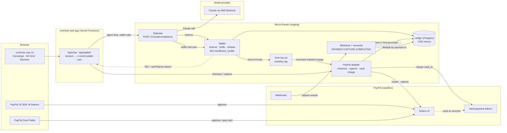

# How to judge confnote (draft)

Draft for the PayPal AI Hackathon. The hosted build is not deployed yet: replace `STAGING_URL` once it is. Everything
runs against the Mochi Router **staging** deployment and the **PayPal sandbox**. No real money moves and no real card
is accepted.

## Before you start

- Open `STAGING_URL` in a desktop browser (the drawers are designed for a wide window).
- Pay only with **PayPal's published sandbox test cards** (PayPal Developer docs, "Card testing"). The demo used the
  Visa `4111 1111 1111 1111` with any future expiry date and any 3-digit CVV. Real cards are refused by the sandbox.
- You do not need a PayPal account. Every step below works with a guest card.

## Try it (about 5 minutes)

| # | Do this | What it proves |
|---|---|---|
| 1 | Sign up on `STAGING_URL` with a new account. Open **Account & AI** (bottom left). | The Router wallet gives every new account USD 2.00 of trial credit from a promo pool; the ledger shows `promo +2.0000`. |
| 2 | Open the **Grids** drawer (AG Grid), tab **Events**. Filter, then set an event's Tracking to **going**. | AG Grid module: the catalogue grid writes tracking, and confnote creates and opens a workspace for the event. |
| 3 | Open the **Planner** drawer (Bryntum). | Bryntum module: the trip view shows the event's city and dates; Conference day and Calendar are one tab away. |
| 4 | Open the **Concierge** and ask for prep tips for the event. Then open Grids → **AI usage**. | Each agent step is metered by the Router wallet (reserve, then settle the real cost; about a cent a step). The AI-usage grid lists each charge and the balance after it. |
| 5 | Keep asking until the balance cannot cover a step (or ask us to drain the test account). | The Router answers **HTTP 402** `insufficient_credits`; the Concierge shows a buy-more card with the balance and what the step needs. |
| 6 | Click **Buy credits**, pick a pack, tick the consent box, pay with PayPal → **Debit or Credit Card** using the sandbox card. | PayPal Orders v2: the Router creates and captures the order. The balance gains the pack plus a USD 2 first-purchase bonus (two ledger rows). PayPal stays disabled until consent is ticked. |
| 7 | Buy another pack with **Save this card for auto top-up** ticked; enter the sandbox card in the in-page fields. | PayPal Card Fields + Vault: the card is saved with the purchase, without a PayPal login. The account menu shows "Card saved · auto top-up on, monthly cap $25.00". |
| 8 | Spend the balance down again (or ask us to drain it) and ask the Concierge one more question. | Auto top-up: when a step needs more than is available, the Router charges the saved card for a pack with no buyer present, and the Concierge answers. The ledger shows an automatic `grant +5.0000`. Untick the box to switch it off. |

If anything fails, the demo video (2:47) shows the same flow recorded on 2026-11-09, and `evidence.json` beside it
holds the API replies with the sandbox order ids.

## Architecture

Notes on the diagram:

- confnote never calls the wallet's reserve or settle routes in paid mode. The Router meters the step itself, so a
  step is never charged twice. The wallet user comes from the confnote session, never from the request body.
- Prices come from the Router's catalogue and price book. The pack price is rechecked at capture, and only an
  approved order can be captured.
- A card is vaulted only when the buyer ticks "Save this card". confnote never sees the card number or the vault
  token.
- The Router can also route Claude to Anthropic directly; per-provider spend ceilings answer 503
  `provider_budget_exhausted` instead of overspending.

## What is and isn't proven

- **Proven on staging + PayPal sandbox (2026-11-09):** steps 1 to 8, with order ids in `evidence.json` (purchase
  `82K50813R58218109`, Card Fields save `5WV91241NE988712Y`, automatic top-up `6B684111VD689205G`).
- **Built and unit-tested, not yet proven live on staging:** PayPal webhook signature verification and delivery to
  staging (reconcile from `webhooks-events` is built and was tested against the sandbox), and PayPal's delayed vault
  token event.
- **Not built:** live PayPal, a production wallet, web chat history (a reopened Concierge drawer starts a new
  thread).
